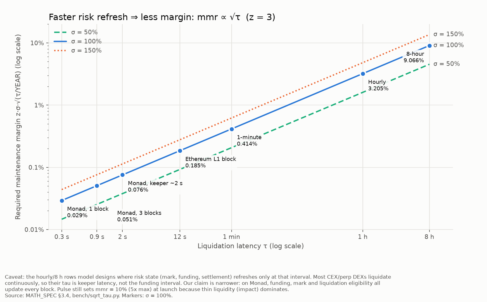

# BENCHMARKS: why only Monad, with numbers (generated)

Generated by `bench/report.ts` on 2026-10-06 at commit `9aee4fe`. Regenerate: `cd contracts && forge test --match-contract RealEngineGasBench && cd ../bench && pnpm report`.
Rules (PRD §7.1, BENCHMARKS_PLAN): every number names its network, block range, commit and date; anvil runs use the Ethereum gas schedule and a local clock and are never presented as testnet/mainnet evidence. **Monad bills the gas limit and its receipts report `gasUsed` = the limit** (checked 30 Sep with receipts and `debug_traceTransaction`), so the testnet column is what a user pays; `eth_estimateGas` (≈ limit / 1.2) is the only view of execution gas.

## B1 / B2: gas per operation
Source: `bench/out/gas_onchain_10143_2026-09-30.csv` — network 10143, blocks 66936436–66936454, commit 1e202d5, 2026-09-30, measured block time 304.3 ms. Foundry column: `contracts/bench-out/real_engine_gas.csv`.

| op | Foundry execution gas (Cancun schedule) | 10143 execution estimate (median) | touch allowance | 10143 billed limit (median) | target |
|---|---|---|---|---|---|
| place | 68,582 | 192,388 | 0 | 230,865 |  |
| cancel | 27,902 | 117,022 | 0 | 140,426 |  |
| place+cancel | 96,484 | 309,409 | 0 | 371,291 | < 100,000 |
| replace | 69,174 | 174,864 | 0 | 209,837 | < 100,000 |
| match 1 fill | 108,275 | 234,660 | 0 | 281,592 |  |
| close 1 fill | — | 203,610 | 0 | 244,332 |  |
| funding first-touch tx | 47,293 | 88,633 | 0 | 106,360 |  |

Source: `bench/out/gas_onchain_10143_2026-10-06.csv` — network 10143, blocks 68742363–68742494, commit 064f327, 2026-10-06, measured block time 304.3 ms. Foundry column: `contracts/bench-out/real_engine_gas.csv`.

| op | Foundry execution gas (Cancun schedule) | 10143 execution estimate (median) | touch allowance | 10143 billed limit (median) | target |
|---|---|---|---|---|---|
| place | 68,582 | 199,428 | 70,000 | 309,313 |  |
| cancel | 27,902 | 117,267 | 70,000 | 210,720 |  |
| place+cancel | 96,484 | 316,694 | 140,000 | 520,033 | < 100,000 |
| replace | 69,174 | 176,154 | 70,000 | 281,385 | < 100,000 |
| match 1 fill | 108,275 | 246,285 | 70,000 | 365,542 |  |
| close 1 fill | — | 177,693 | 70,000 | 283,232 |  |
| funding first-touch tx | 47,293 | 89,298 | 70,000 | 177,158 |  |

_This file predates the `gasEstimate` column: its limits were built as ⌈estimate × 1.2⌉ + 70,000 (`bench/gas_onchain.ts` at its commit), so the estimate is derived as (limit − allowance) / 1.2._

Source: `bench/out/gas_onchain_10143_2026-10-06-p7.csv` — network 10143, blocks 68785334–68785397, commit 9aee4fe, 2026-10-06, measured block time 300.0 ms. Foundry column: `contracts/bench-out/real_engine_gas.csv`.

| op | Foundry execution gas (Cancun schedule) | 10143 execution estimate (median) | touch allowance | 10143 billed limit (median) | target |
|---|---|---|---|---|---|
| place | 68,582 | 199,396 | 70,000 | 309,276 |  |
| cancel | 27,902 | 117,266 | 70,000 | 210,720 |  |
| place+cancel | 96,484 | 316,662 | 140,000 | 519,996 | < 100,000 |
| replace | 69,174 | 176,242 | 70,000 | 281,491 | < 100,000 |
| match 1 fill | 108,275 | 197,228 | 70,000 | 306,674 |  |
| close 1 fill | — | 177,666 | 70,000 | 283,200 |  |
| funding first-touch tx | 47,293 | 89,501 | 70,000 | 177,402 |  |

Reading: the < 100k place + cancel target is met on the Foundry (Cancun) schedule. On Monad testnet `eth_estimateGas` for the same ops is ≈ 3.2× higher (MIP-8 charges 8,100 per cold storage page read), and Monad bills the **limit**, not the gas used: ⌈estimate × 1.2⌉ plus, since 5 Oct, a 70,000 `TOUCH_ALLOWANCE_GAS` on every tx (a `latest` estimate misses the block's first funding touch; without it a `replaceOrder` ran out of gas on 5 Oct). The per-market funding touch is O(1) and flat in the number of positions (`test/unit/ClearingHouseGas.t.sol`).

**Found #19 (6 Oct receipts up vs 30 Sep), settled:** the 6 Oct limits carry the 70,000 allowance and the 30 Sep ones don't (`bench/gas_onchain.ts` at `064f327` vs `1e202d5`). With it taken out, the 6 Oct execution estimates are +0.2% (cancel) to +5% (match) over 30 Sep (P2/P3 code growth and book state), not +40–50%. The 7 Oct (IST) rerun records `eth_estimateGas` next to every receipt and reproduces the derived 6 Oct estimates within 0.2% for place, cancel, replace, close and funding (match 197,228 vs 246,285: the fill's cost depends on the resting maker's state); every receipt's `gasUsed` equals ⌈estimate × 1.2⌉ + 70,000. Lowering the billed cost means a smaller allowance: only the first tx in a block pays the touch, so a bot that knows it is not first (or estimates on `pending`, RUNBOOK §1 > VERIFY) can drop it.

5 Oct rerun (decision D12): aborted after 18 receipts, not used in the table above. The testnet endpoint was a free tier (BLOCKED #5) and the bench wallet ran out of MON; a `replaceOrder` at ⌈estimate × 1.2⌉ ran out of gas (the `latest` estimate misses the block's first funding touch), so `gasLimitFor` now adds `TOUCH_ALLOWANCE_GAS` (70,000 on live chains). Rebuilt read-only: `bench/out/partial_gas_onchain_10143_2026-10-05.csv`.

**B2 funding update (Foundry, Cancun schedule, local; commit 9aee4fe):** CH-own first-touch incremental 29,453 (target < 30,000) · checkpoint block 30,169 (< 40,000) · later touch in the same tx 1,528 (< 3,000) · whole first-touch tx 47,293.

## B3: MIP-8 storage layout effect
_**Cut** (owner decision D12, 5 Oct): B3 needs the same MM cycle on a level-array vs a mapping-layout OrderBook, measured on testnet (BENCHMARKS_PLAN B3). The mapping-layout variant would be a bench-only contract to write, deploy and fund before the 8 Oct freeze, for a claim the Foundry B1 numbers and MIP-8 page pricing already explain. Not run; no number is claimed._

## B4: multi-market parallel load
_Not run on testnet: **BLOCKED #5 paid RPC** (HUMAN_CHECKLIST #5). Decision D12 approved a reduced B4 on 10143 within ≤ 2.0 testnet MON on a non-public RPC; on 5 Oct the configured testnet endpoint turned out to be a **free tier** (`eth_getLogs` ≤ 10 blocks, HTTP 429 under a short scan), and the keys hold ≈ 1.25 testnet MON after the aborted B1/B2 rerun (`bench/out/partial_gas_onchain_10143_2026-10-05.csv`, not used here). Smallest meaningful B4 (`DRY_RUN=1`, 2 wallets × 15 txs × K = 1, 2) projects ≈ 1.38 MON + 12 unpriced setup txs; full B4 (4 × 60) ≈ 5.2 MON. `bench/load.ts` is ready (K markets, pipelined nonces; outputs record the RPC tier, never the URL)._

## B5 funding granularity · B8 UX latency · B9 vault economics
_Pending: B5 and B9 need indexer history (live Envio pending Docker); B8 needs the login decision + app instrumentation._

## B6: √τ margin chart

| design | τ (s) | z·σ·√τ at σ = 100% (%) | implied max leverage |
|---|---|---|---|
| Monad, 1 block | 0.3 | 0.029 | 3,418x |
| Monad, 3 blocks | 0.9 | 0.051 | 1,973x |
| Monad, keeper ~2 s | 2.0 | 0.076 | 1,324x |
| Ethereum L1 block | 12.0 | 0.185 | 540x |
| 1-minute | 60.0 | 0.414 | 242x |
| Hourly | 3600.0 | 3.205 | 31x |
| 8-hour | 28800.0 | 9.066 | 11x |

Honesty caveat (MATH_SPEC §3.4): the hourly / 8 h rows model designs whose risk state refreshes only at that interval; continuous-liquidation venues have τ = keeper latency. The claim is that funding, mark and liquidation eligibility all update every block here.

## B7: liquidation latency (realized)
Source `bench/out/b7_liquidation_latency.csv` (every row has its blocks, tx, RPC and bots commit).

| network | n | p50 (blocks after eligible) | p95 | max | blocks after the oracle push (p50) | target |
|---|---|---|---|---|---|---|
| anvil-10143 | 3 | 1 | 1 | 1 | 1 | ≤ 3 |
| 10143 | 4 | 5 | 8 | 8 | 5 | ≤ 3 |

Testnet misses the ≤ 3-block target. It ran on the free public RPC, where the keeper's estimate + send + receipt path took ≈ 3.2 s (8 blocks of 400 ms); the target assumes a keeper on its own paid RPC. Locally the same keeper liquidates 1 block after eligibility.

